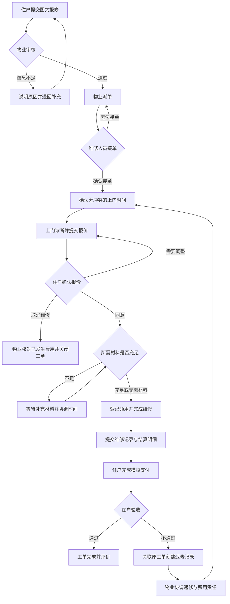

# 社区报修与上门维修服务平台

> 微服务开发与实践｜霍利屹｜2412190707｜第五周：Docker 容器化与持久化验证

本项目解决社区报修信息分散、派单不及时和进度难追踪的问题。当前在原 `monolith/` 中实现“住户提交报修 → 物业审核 → 按技能派单 → 维修人员确认接单”的完整受理流程，并使用 MySQL 持久化。Java 基础包保持 `com.zjgsu.hly`，新增分层代码放入其子包。

## 第五周：容器运行（推荐）

本周使用 Docker 将现有应用和 MySQL 8.4.11 一起启动，无需在宿主机安装 Java 或 Maven。多阶段构建自动编译并运行测试，运行镜像仅包含 JRE 与应用 JAR。

在 **Ubuntu 仓库根目录**执行：

```bash
cp .env.example .env
# 编辑 .env，设置 MYSQL_PASSWORD 和 MYSQL_ROOT_PASSWORD
sudo docker build -t community-repair:week05 ./monolith
sudo docker compose up -d --build
sudo docker compose ps
sudo docker compose logs --tail=50 app
```

应用通过数据库服务名 `mysql` 连接，等待数据库健康后启动；真实 `.env` 已忽略，模板 `.env.example` 可提交。命名卷保留 MySQL 数据，容器内部应用端口 8080，宿主机映射 8081（可通过 APP_PORT 调整）。

```bash
curl --noproxy '*' -i http://localhost:8081/actuator/health
curl --noproxy '*' -i -H 'Content-Type: application/json' --data-binary @monolith/examples/order.json http://localhost:8081/api/repair-orders
curl --noproxy '*' -i http://localhost:8081/api/repair-orders
```

Windows 访问 VMware 中的应用时使用 `http://192.168.158.128:8081`，不是 Windows 的 localhost。Ubuntu 内使用 localhost。以上业务接口分别验证创建（201）和查询（200）。

```bash
python3 scripts/verify-container.py before
sudo docker compose down
sudo docker compose up -d
# 等待健康接口返回 UP
python3 scripts/verify-container.py after
sudo docker compose stop
```

`down` 删除容器但保留数据卷；不要加 `-v`。`stop` 只停止服务，恢复使用 `sudo docker compose start`。修改 .env 中的数据库密码不会自动修改已有数据卷内的账号密码。

本机共享挂载需先同步到 `~/community-repair-week05` 再构建，具体命令、实际验证结果和截图见 [第五周作业记录](docs/homework/week-05/index.md)。以下本地 Java/MySQL 启动说明仍供第四周开发使用。

## 环境要求

| 项目 | 要求 |
|---|---|
| Java | JDK 25，`JAVA_HOME` 指向 JDK 25；IDEA Project SDK 和 Maven Runner 也选择 JDK 25 |
| Spring Boot | 4.0.8 |
| Maven | 自带 Wrapper 固定 Maven 3.9.16，无需全局 Maven；首次下载依赖需要联网 |
| 正式运行数据库 | 本地 MySQL 8.0+；本机验证版本为 MySQL 9.5.0 |
| 测试数据库 | H2 内存库，仅 test scope；执行测试不需要 MySQL 或密码 |
| 配置/端口 | `monolith/src/main/resources/application.yml`；默认 8080，可用 `SERVER_PORT` 覆盖 |

## 工程结构

```text
README.md
docs/
  project-proposal.md
  database.md
  homework/week-04/index.md
monolith/
  pom.xml / mvnw / mvnw.cmd / .mvn/
  examples/                         # 可直接提交的请求 JSON
  scripts/                          # 建库 SQL、流程演示脚本
  src/main/java/com/zjgsu/hly/
    CommunityRepairApplication.java
    model/                          # Technician、RepairOrder、枚举
    dto/                            # 请求校验与响应 DTO
    controller/                     # HTTP 输入输出
    service/                        # 状态、技能、可接单检查及事务
    repository/                     # Spring Data JPA 数据访问
    exception/                      # 统一 400/404/409 错误响应
  src/main/resources/application.yml
  src/test/java/com/zjgsu/hly/        # 上下文、Repository、Service、API 测试
  src/test/resources/application-test.yml
```

## 本地 MySQL 安装、建库与连接

1. 从 [MySQL 官方下载页](https://dev.mysql.com/downloads/mysql/) 安装本地 MySQL Community Server，完成初始化并启动服务，记住管理员密码。Windows 可在服务管理器中确认 MySQL 服务正在运行；无需 Docker Compose。
2. 执行 `mysql -u root -p`，交互输入密码。打开 `monolith/scripts/create-database.sql`，将其中的密码占位符替换成自己的应用密码后，在 MySQL 客户端执行该脚本。它创建独立的 `community_repair` 库和仅有该库必要权限的 `community_app` 账号，不删除已有数据。
3. 配置 `DB_URL`、`DB_USERNAME`、`DB_PASSWORD` 环境变量。不要把真实密码提交到 GitHub。`CREATE USER IF NOT EXISTS` 不会修改已有账号的密码。
4. 首次启动通过 JPA 的 `ddl-auto: update` 创建表，后续重启保留数据。此配置适用于课程开发；正式部署应使用迁移脚本和 schema 校验。

本机已创建课程数据库和专用应用账号，连接配置保存在 **`monolith/.env.local.ps1`**，已由 `.gitignore` 排除。其他机器没有这个文件，应按上述步骤自行配置。

### Windows PowerShell（本机）

在仓库根目录执行：

```powershell
cd monolith
$env:JAVA_HOME = 'C:\Program Files\JetBrains\IntelliJ IDEA 2026.2.3\jbr'
$env:Path = "$env:JAVA_HOME\bin;$env:Path"
. .\.env.local.ps1
.\mvnw.cmd spring-boot:run
```

其他机器替换 JDK 路径，并改为设置自己的连接信息：

```powershell
$env:DB_URL = 'jdbc:mysql://localhost:3306/community_repair?connectionTimeZone=Asia/Shanghai&characterEncoding=UTF-8'
$env:DB_USERNAME = 'community_app'
# 使用自己设置的数据库密码；不要截图或提交含密码的设置命令
$env:DB_PASSWORD = '<本机应用账号密码>'
.\mvnw.cmd spring-boot:run
```

### Linux、macOS 或 Git Bash

```bash
cd monolith
export DB_URL='jdbc:mysql://localhost:3306/community_repair?connectionTimeZone=Asia/Shanghai&characterEncoding=UTF-8'
export DB_USERNAME='community_app'
read -r -s -p 'Database password: ' DB_PASSWORD
export DB_PASSWORD
./mvnw spring-boot:run
```

IDEA 打开 `monolith/pom.xml`，等待 Maven 同步，配置 JDK 25 和 Wrapper。在运行配置的 Environment variables 中设置相同的数据库变量，再运行启动类或 `spring-boot:run`。IDEA 环境变量与另一个终端的变量不会自动共享。

默认访问端口是 8080。若被其他应用占用，可在 PowerShell 设置 `$env:SERVER_PORT='8081'`，并将下方请求地址中的端口改为 8081。本次真实 MySQL 验证使用了 8081，项目默认值未改。使用 Ctrl+C 或 IDEA 停止按钮结束应用。

## 业务接口与规则

| 方法 | 路径 | 请求/成功结果 |
|---|---|---|
| POST | `/api/technicians` | 创建人员，201；name、phone、skill、available |
| GET | `/api/technicians` | 查询人员列表，200 |
| POST | `/api/repair-orders` | 创建工单，201，Location 指向详情；residentName、contactPhone、location、description、category |
| GET | `/api/repair-orders` | 查询工单列表，200 |
| GET | `/api/repair-orders/{id}` | 查询工单详情，200 |
| POST | `/api/repair-orders/{id}/review` | `{ "approved": true, "note": "通过" }`，200 |
| POST | `/api/repair-orders/{id}/assign` | `{ "technicianId": 1 }`，200 |
| POST | `/api/repair-orders/{id}/accept` | `{ "technicianId": 1 }`，200 |

类别/技能可选 `PLUMBING`（水管）、`ELECTRICAL`（电路）、`LOCK`（门锁）。状态顺序为 SUBMITTED → APPROVED → ASSIGNED → ACCEPTED，审核不通过则进入 REJECTED。

Service 保证：只有已审核工单可派单；维修人员必须可接单且技能匹配；只能由被分配人员确认，不能重复接单。违反规则返回 409；资源不存在返回 404；参数校验失败返回 400。错误响应格式为 `{"status":409,"message":"具体原因"}`。更新使用事务和乐观锁，Controller 不直接操作 Repository。

### 可直接运行的 curl 示例

以下命令在 `monolith/` 目录执行。Linux/macOS/Git Bash 使用 `curl`；Windows PowerShell 使用 `curl.exe` 替换 `curl`，避免同名别名。`--noproxy` 防止系统代理干扰 localhost。请求数据使用仓库中的 UTF-8 文件，避免不同终端的 JSON 引号问题。

```bash
curl --noproxy localhost -i -H "Content-Type: application/json" --data-binary @examples/technician.json http://localhost:8080/api/technicians
curl --noproxy localhost -i -H "Content-Type: application/json" --data-binary @examples/order.json http://localhost:8080/api/repair-orders
curl --noproxy localhost -i http://localhost:8080/api/repair-orders
```

第一条使用固定演示电话，重复执行可能返回 409（唯一约束生效）；工单创建每次生成新 id。审核和派单需使用创建响应中的真实编号，不要假设永远为 1。完整的可重复演示（PowerShell 7）会自动使用真实编号：

```powershell
.\scripts\demo.ps1
# 如果使用临时端口：
.\scripts\demo.ps1 -BaseUrl http://localhost:8081
```

### 基础接口与健康检查

- [问候接口](http://localhost:8080/api/hello)：返回项目名称与问候消息。
- [Actuator 健康检查](http://localhost:8080/actuator/health)：返回 `status: UP`；本周已接入数据库，数据库连接也参与健康检查。
- [原状态接口](http://localhost:8080/api/status)：保留应用名称与 UP 响应；它是简单响应，不代替 Actuator 检查。

## 自动化测试与验证结果

进入 `monolith/` 执行，不需启动 MySQL 或设置连接密码：

```bash
./mvnw test
```

Windows PowerShell 使用 `.\mvnw.cmd test`。测试显式激活 `test` profile，以 H2 内存库自动建表并准备测试数据；不会清空本地 MySQL。

2026-10-12 已连续两次通过：**17 项测试，0 失败、0 错误，BUILD SUCCESS**。包括上下文/基础接口 4 项、Repository 2 项、Service 6 项、业务 API 5 项。Repository 测试通过清除一级缓存再查询验证落库，Service 覆盖技能不匹配等失败分支，API 覆盖完整流程与 400/404/409。

本机 MySQL 9.5 实测完成工单 1 的提交、审核、派单和接单；重复接单返回 409；应用重启后仍能查询到 ACCEPTED 状态和人员关联，证明数据持久化。详细证据、作业填写文本及截图步骤见 [第四周记录](docs/homework/week-04/index.md)。

## 当前尚未实现的能力

- 登录认证、角色授权、住户身份校验和房屋管理；当前角色由接口调用行为模拟，不能用于真实多用户环境。
- 上门时间预约与冲突检测、实际维修、报价、库存、支付、验收、评价、返修。
- 原工单重提、重新派单、人员修改/删除、分页查询和完整操作审计。
- 微服务拆分、消息队列、分布式事务、完整业务监控与生产部署；应用和 MySQL 的基础容器部署已在第五周完成。

数据库模型、Service、Repository 和业务 API 已在第四周实现，不再属于“仅规划”。以下完整产品设计仍包含尚未实现的后续目标。

资料：[项目规划](docs/project-proposal.md)｜[数据库设计](docs/database.md)｜[第三周](docs/homework/week-03/index.md)｜[第四周](docs/homework/week-04/index.md)。

## 一、项目目标和适用场景

### 项目目标

传统社区报修通常依赖电话、微信群或纸质登记，容易出现信息遗漏、重复报修、派单不及时、维修进度不透明和收费依据难以追溯等问题。本项目计划通过统一平台实现：

- **统一登记：** 集中保存故障描述、图片、位置和联系方式，减少信息反复确认。
- **过程可追踪：** 记录审核、派单、预约、维修和验收过程，方便各方了解处理进度。
- **责任可明确：** 工单关联处理人员，保留状态变化与操作记录。
- **费用可核对：** 展示维修报价、材料用量与费用明细，区分公共维修和住户自费维修。
- **管理可统计：** 汇总工单数量、处理时长、超时情况和评价，辅助物业改进服务。

### 适用场景

| 场景 | 示例 | 处理特点 |
|---|---|---|
| 住户自费维修 | 室内水管漏水、门锁损坏、插座故障 | 住户确认报价后维修，完成费用结算和验收 |
| 社区公共设施维修 | 楼道照明损坏、公共区域设施故障 | 物业确认维修责任和费用承担方式，住户无需个人支付 |
| 维修后返修 | 同一故障处理后仍未解决 | 返修记录关联原工单，保留历史处理过程 |

初期服务于单个社区，由物业协调维修人员提供服务。

## 二、主要用户角色及需求

| 角色 | 核心需求 | 主要操作与数据范围 |
|---|---|---|
| 住户 | 方便报修、知道处理进度、了解收费依据、反馈维修结果 | 管理自己的房屋信息；提交和查看自己的工单；确认报价；模拟支付；验收、评价及申请返修 |
| 维修人员 | 获取完整故障信息、合理安排上门时间、记录工作和材料使用 | 查看分配给自己的工单；接单或说明无法接单原因；更新维修进度；填写报价、维修记录及材料用量 |
| 物业管理员 | 及时协调人员、处理异常、掌握社区维修情况 | 审核与派发社区工单；调整预约；处理超时、返修和投诉；管理材料库存；查看业务统计 |
| 平台管理员 | 维护账号、权限和基础配置，保障系统运行 | 管理用户与角色；维护维修类别和收费标准；查看审计记录及系统运行信息 |

角色权限与数据范围同时控制。例如，住户不能通过修改工单编号查看他人的报修记录，维修人员不能处理未分配给自己的工单。

## 三、功能模块划分

| 模块 | 具体功能 | 关键规则 |
|---|---|---|
| 用户与房屋管理 | 用户登录与退出；账号启用或停用；角色分配；住户房屋及联系方式维护；维修人员技能信息维护 | 房屋与住户建立关联；账号权限由管理员维护；联系信息仅向业务相关人员开放 |
| 基础资料管理 | 维修类别、公共区域位置、收费项目与参考标准维护 | 调整收费标准不改变历史工单已经确认的报价 |
| 报修与工单管理 | 创建图文报修；选择房屋或公共位置；填写故障与期望时间；审核、驳回和补充信息；查询工单及状态历史 | 区分公共维修与自费维修；驳回需说明原因；只允许符合规则的状态变化 |
| 派单与预约管理 | 按维修类别和人员技能手动派单；接单确认；无法接单反馈；预约上门；改约与重新派单；超时标记 | 同一人员不能接受时间冲突的预约；改约与重新派单保留操作记录 |
| 报价与维修管理 | 登记故障诊断；填写人工及材料报价；住户确认自费报价；记录维修开始、过程及完成情况；上传维修结果 | 自费维修在报价确认后实施；报价变化需再次确认；维修完成时提交处理记录 |
| 材料与库存管理 | 材料档案；期初库存及入库登记；领用、退回与库存查询；按工单记录材料用量 | 库存不足不允许领用；库存变化保留流水；重复提交不能重复扣减 |
| 费用与结算管理 | 展示人工费和材料费；确认费用承担方；生成结算单；模拟支付与支付结果查询 | 公共维修不要求住户个人支付；支付金额以确认的结算单为准；重复支付通知不能重复结算 |
| 验收、评价与返修 | 住户确认维修结果；填写评价；验收不通过时申请返修；物业处理争议与投诉 | 返修关联原工单；保留原维修和费用记录；新增收费需重新确认，不能直接重复收费 |
| 通知与业务统计 | 展示派单、改约、报价确认及完成通知；统计工单数量、状态分布、处理时长和评价情况 | 初期使用站内通知；统计结果受角色权限限制；后续引入异步消息 |

### 工单状态与处理约束

主要状态包括：待审核、待派单、待接单、待预约、待上门、待报价确认、维修中、待结算、待验收、已完成、已驳回和已取消。

- 审核通过后进入派单流程；驳回时记录原因，住户可补充信息后重新提交。
- 维修人员无法接单时，工单回到待派单；预约冲突时需重新选择时间或人员。
- 自费维修需确认报价；公共维修由物业确认费用承担方式及维修方案。
- 维修完成后，自费工单完成模拟支付再进入验收；公共维修登记费用后进入验收。
- 验收失败进入返修处理，关联原工单并重新安排维修；不覆盖原有处理记录。
- 未开始维修的工单可申请取消，由物业确认是否存在已发生费用或材料领用，处理后关闭；维修中的工单通过异常处理结束。

## 四、核心业务流程

以下以“住户家中水管漏水，需要自费上门维修”为例。

1. **提交报修：** 住户选择自己的房屋，填写漏水位置、故障描述、图片及期望上门时间。
2. **审核与派单：** 物业确认报修信息和费用承担方，选择具备相关技能的维修人员。
3. **接单与预约：** 维修人员确认接单，与住户确定无时间冲突的上门时段。
4. **诊断与报价：** 维修人员上门检查，填写人工费、预计材料及报价，住户在线确认。
5. **领料与维修：** 系统检查材料库存，领用成功后记录库存扣减；维修人员实施维修并填写实际用量和处理结果。若费用变化，需重新确认报价。
6. **结算与支付：** 生成费用明细和结算单，住户完成模拟支付，系统可靠记录支付结果并更新工单。
7. **验收与评价：** 住户检查维修结果，验收通过后工单完成并可评价；未通过则申请返修，由物业协调后续处理。



公共设施报修沿用审核、派单、预约和维修流程，由物业确认方案和费用，跳过住户个人支付步骤。返修是否收费需根据责任和实际情况确认，不能因重新进入维修流程而自动重复收费。

## 五、当前项目范围与暂不实现的内容

### 本阶段规划范围

- 面向单个社区，围绕住户、维修人员、物业管理员和平台管理员四类角色开展设计。
- 优先实现报修、人工审核派单、预约、报价、维修记录、模拟结算和验收的完整流程。
- 提供基础材料库存与领用记录、工单查询、站内通知和简单统计。
- 明确数据模型、状态变化与权限边界，再按照课程进度逐步实现。

### 暂不实现

| 内容 | 范围说明 |
|---|---|
| 多社区及多租户平台 | 初期不处理跨物业公司的数据隔离和组织管理 |
| 智能派单与地图服务 | 使用人工派单，不提供实时轨迹、路线规划或智能推荐 |
| 真实支付与复杂财务 | 使用模拟支付，不接入银行或第三方支付，不实现发票及完整财务核算 |
| 完整供应链 | 保留基础库存与入库，不实现采购审批、供应商和采购合同管理 |
| 外部通知渠道 | 初期不接入短信、电话或第三方即时通信平台 |
| 智能硬件与算法 | 不接入门禁、传感器等设备，不实现故障自动诊断 |

## 六、后续技术演进方向

### 认证与授权

统一处理登录认证、登录失效和账号停用；结合角色权限与资源归属控制接口访问。后续可通过网关校验访问令牌，各业务服务继续校验操作权限及数据范围，避免只依赖前端页面隐藏功能。

### 服务拆分

初期按模块组织代码，优先完成业务闭环；后续按业务职责逐步拆分，而非将每张数据表直接拆成一个服务。

| 候选服务 | 主要职责与数据归属 |
|---|---|
| 用户服务 | 用户、角色、住户房屋、维修人员基础资料 |
| 工单服务 | 报修信息、工单状态、维修记录、验收、评价及返修关联 |
| 调度服务 | 派单、人员预约时段、改约记录与冲突检查 |
| 材料服务 | 材料档案、库存、领用与退回流水 |
| 结算服务 | 报价及确认记录、费用明细、结算单、模拟支付记录 |
| 通知服务 | 通知模板、接收对象、发送记录及重试状态 |

每个服务负责自己的数据写入。跨服务通过接口或事件协作，逐步减少共享数据库表和跨服务直接修改数据的情况。

### 消息通信

将工单已派发、预约已调整、报价待确认、维修已完成和支付已成功等变化发布为事件，用于通知与后续业务处理。为事件分配唯一标识，记录消费结果，支持失败重试及重复消费去重。消息积压或持续处理失败时应能被监控发现。

### 事务与一致性

- **本地事务：** 材料领用记录与库存扣减一起提交或回滚；结合并发控制防止库存扣成负数。
- **预约一致性：** 在调度服务内校验并锁定预约时段，避免并发请求造成重复占用。
- **跨服务一致性：** 模拟支付成功后，结算服务保存支付记录及待发送事件，再通过消息推动工单进入待验收状态，后续可实践本地消息表等可靠事件发布方案。
- **幂等与补偿：** 支付事件重复到达时只更新一次；取消工单时按实际领用情况释放预约、退回未使用材料。跨服务操作失败时重试或执行补偿，保留可追踪记录。

### 监控与可观测性

集中收集服务日志，为跨服务请求关联统一追踪标识；监控接口耗时、错误率、服务健康状态、消息积压和处理失败次数。同时关注待派单时长、超时工单数等业务指标，便于区分系统故障与业务处理延迟。

### 部署与运行

先完成本地开发与数据库持久化，再使用容器部署应用、数据库和消息组件。后续引入统一网关、按环境区分的配置、健康检查及自动构建部署流程；敏感配置通过环境变量等方式注入，不写入仓库。结合课程进度实践多服务启动、服务间访问和故障排查。

## 七、阶段性实施安排

| 阶段 | 主要产出 | 验证重点 |
|---|---|---|
| 需求设计 | 项目说明、功能边界、业务流程和数据模型 | 角色职责明确，核心流程能够闭环 |
| 基础实现 | 持久化、基础页面或接口、工单完整流程 | 数据可保存，状态流转及权限符合规则 |
| 微服务演进 | 服务拆分、统一认证、服务间接口 | 各服务职责清晰，正常与异常调用可处理 |
| 可靠性建设 | 消息、幂等、事务及补偿机制 | 重复消息、处理失败和并发操作不造成错误结果 |
| 运行与部署 | 容器化、日志、指标和调用链 | 服务可部署，异常能够被发现和定位 |

选题背景与初步边界见 [第二周作业说明](docs/homework/week-02/index.md)。