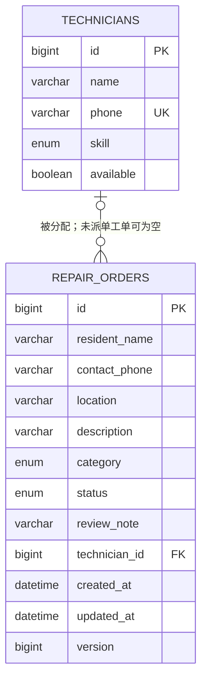

# 数据库设计（第四周）

## 运行环境与初始化

正式运行使用 MySQL，数据库名 `community_repair`，字符集 utf8mb4；自动化测试使用 H2 内存数据库的 MySQL 模式，不需要本机 MySQL。连接信息通过 `DB_URL`、`DB_USERNAME`、`DB_PASSWORD` 传入。

首次在空课程数据库启动时，JPA 根据实体建表，`spring.jpa.hibernate.ddl-auto=update` 用于课程开发和重启保留数据，不在正常启动时删除或清空表。生产环境应改用版本化迁移与 `validate`。H2 测试使用 `create-drop`，仅针对内存库。

## 表关系



## technicians（维修人员）

| 字段 | 类型/长度 | 约束与说明 |
|---|---|---|
| id | BIGINT | 自增主键 |
| name | VARCHAR(50) | 非空，人员姓名 |
| phone | VARCHAR(20) | 非空、唯一约束 uk_technician_phone |
| skill | 字符串枚举 | 非空，PLUMBING / ELECTRICAL / LOCK |
| available | BOOLEAN | 非空，是否可接单 |

## repair_orders（报修工单）

| 字段 | 类型/长度 | 约束与说明 |
|---|---|---|
| id | BIGINT | 自增主键 |
| resident_name | VARCHAR(50) | 非空 |
| contact_phone | VARCHAR(20) | 非空 |
| location | VARCHAR(200) | 非空 |
| description | VARCHAR(1000) | 非空 |
| category | 字符串枚举 | 非空，与 skill 使用相同枚举 |
| status | 字符串枚举 | 非空，SUBMITTED / APPROVED / REJECTED / ASSIGNED / ACCEPTED；索引 idx_order_status |
| review_note | VARCHAR(300) | 创建时可空，审核时 DTO 要求提供说明 |
| technician_id | BIGINT | 可空；外键 fk_order_technician；关联 technicians.id；无级联删除 |
| created_at | DATETIME(6) | 非空，创建后不更新 |
| updated_at | DATETIME(6) | 非空，实体变更时更新 |
| version | BIGINT | JPA 乐观锁版本号，由 Hibernate 管理 |

Hibernate 在 MySQL 上可能使用原生 ENUM 保存 `EnumType.STRING`，Java 中不依赖枚举序号。表的实际类型可用 `SHOW CREATE TABLE` 查看。

必要约束包括主键、必填字段、电话唯一、工单到维修人员的外键。状态转换和技能匹配属于跨字段/跨表业务规则，由 Service 检查，数据库外键不能代替该规则。数据验证另限制姓名、位置、故障描述长度及电话格式。

## Repository 与事务

`TechnicianRepository` 和 `RepairOrderRepository` 继承 `JpaRepository`，位于 `com.zjgsu.hly.repository`。Controller 不直接访问 Repository。`RepairService` 的写操作使用 `@Transactional`，并在返回前 flush；重复电话或并发版本冲突被统一转换为 HTTP 409。

## 可重复测试数据与验证

- Repository 测试每次创建测试人员及工单，在 flush 后清除 EntityManager 缓存再查询，验证真实数据库读写与关联关系；同时验证电话唯一约束。
- Service 测试使用事务回滚隔离数据，覆盖完整受理流程及规则失败分支。
- API 测试通过真实 HTTP 在随机端口访问，使用独立测试电话自动创建数据。
- `monolith/scripts/demo.ps1` 可在本地 MySQL 应用运行时重复执行，复用演示人员并每次创建一条新的演示工单，不删除已有数据。
- MySQL 可使用以下查询核对关联与状态，并在应用重启后再次查询验证数据保留：

```sql
SELECT o.id, o.status, o.location, t.name, t.skill
FROM repair_orders o LEFT JOIN technicians t ON o.technician_id = t.id
ORDER BY o.id;
SHOW CREATE TABLE technicians;
SHOW CREATE TABLE repair_orders;
```

## 参考资料

- [Spring Boot SQL 数据库配置](https://docs.spring.io/spring-boot/4.0/reference/data/sql.html)
- [Spring 官方 MySQL 与 JPA 指南](https://spring.io/guides/gs/accessing-data-mysql/)
