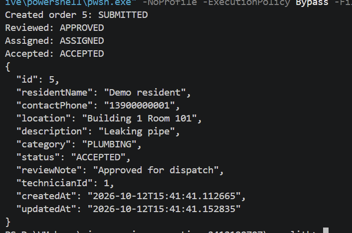
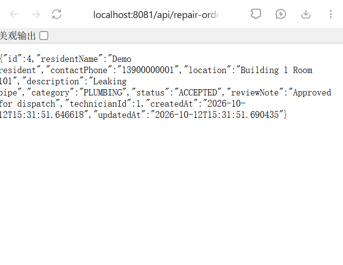
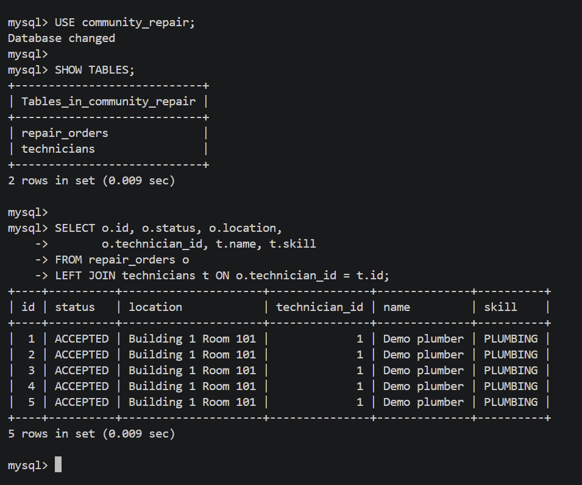
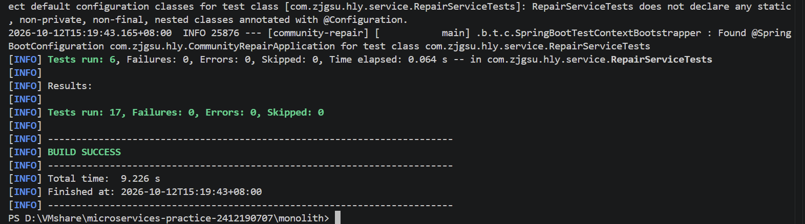

# 第四周：单体应用与数据库持久化

项目：社区报修与上门维修服务平台。仓库：https://github.com/shigaharuki17/microservices-practice-2412190707

继续使用 `monolith/` 和 `com.zjgsu.hly` 基础包，本周实现报修受理流程，不另建工程。

## 一、业务建模

流程：SUBMITTED（提交）→ APPROVED（审核通过）→ ASSIGNED（派单）→ ACCEPTED（接单）；审核失败为 REJECTED。

两个实体为 RepairOrder 和 Technician，通过可空外键构成多对一关系。Service 检查状态前置条件、维修人员可接单与技能匹配、接单人员一致性。技术细节见 [项目规划](../../project-proposal.md)。本周完成边界是报修受理和接单，不是实际维修结束。

## 二、单体应用实现

- model、dto、controller、service、repository、exception 放在基础包子包。
- 提供 8 个业务 REST 接口，包含人员与工单创建/查询、审核、派单和接单。
- 创建返回 201；查询和操作成功返回 200；参数错误 400、缺失资源 404、业务冲突 409。
- Controller 不访问 Repository；事务和选题规则在 RepairService 内实现；输入和输出均使用 DTO。

从 `monolith/` 启动（本机 PowerShell）：

```powershell
. .\.env.local.ps1
$env:SERVER_PORT='8081' # 仅因本次验证时 8080 已被占用；项目默认端口为 8080
.\mvnw.cmd spring-boot:run
```

另开 PowerShell 7，进入 `monolith/` 执行：

```powershell
.\scripts\demo.ps1 -BaseUrl http://localhost:8081
```

实际结果：工单 1 依次进入 SUBMITTED、APPROVED、ASSIGNED、ACCEPTED；再次请求接单返回 409。完整响应记录见 [mysql-workflow.txt](mysql-workflow.txt)。curl 示例和环境设置见 [根目录 README](../../../README.md)。

## 三、数据库持久化

- 使用本机 MySQL 9.5.0 的独立 `community_repair` 数据库。
- 两张业务表为 technicians 和 repair_orders，包含主键、电话唯一约束、状态索引和人员外键。
- Spring Data JPA Repository 执行读写，工单使用版本字段防止更新覆盖。
- 正常启动 `ddl-auto=update` 保留数据，测试 `create-drop` 只用于 H2 内存库。
- 应用使用专用受限账号，凭据存于本机忽略文件，不提交；新环境使用 `scripts/create-database.sql` 建库并自行设定密码。

验证：流程运行后直接查询 MySQL 表，能看到工单 1、人员关联和 ACCEPTED 状态；停止并重新启动应用后再次查询，数据仍在。

证据：[数据库结构与关联查询](mysql-tables.txt)、[重启后查询响应](mysql-after-restart.json)。表字段和约束见 [docs/database.md](../../database.md)。

## 四、测试与验证

在 `monolith/` 执行：

```bash
./mvnw test
```

PowerShell 使用 `.\mvnw.cmd test`。测试使用 H2，不要求配置 MySQL；数据由测试代码自动创建，Repository/Service 测试通过事务回滚隔离，API 测试启动随机端口。

| 测试层 | 项数 | 验证内容 |
|---|---:|---|
| 上下文与基础接口 | 4 | contextLoads、原状态、问候、Actuator |
| Repository | 2 | flush/清除缓存后读取关联；唯一约束 |
| Service | 6 | 完整流程；技能不匹配；不可接单；越过审核；人员不符/重复接单；驳回后不可派单 |
| API | 5 | 完整 HTTP 流程、201/200、参数 400、缺失 404、规则 409、非法枚举 400 |

2026-10-12 两次运行均成功：

```text
Tests run: 17, Failures: 0, Errors: 0, Skipped: 0
BUILD SUCCESS
```

真实 MySQL 验证使用 8081，健康检查返回 UP。H2 测试结果不代替 MySQL 验证，本周两种环境均已实际运行。

## 五、运行截图

以下图片为本人于 2026-10-12 实际运行时截取的原始截图，已归档到 `screenshots/`。

| 截图 | 内容 | 作业小题 |
|---|---|---|
| [01-workflow.png](screenshots/01-workflow.png) | 5 号工单经历提交、审核、派单、接单四个状态，最终为 ACCEPTED | 单体应用实现 |
| [02-order-detail.png](screenshots/02-order-detail.png) | 浏览器查询 4 号工单，返回 ACCEPTED 及关联维修人员编号 | 单体应用实现 |
| [03-mysql-persistence.png](screenshots/03-mysql-persistence.png) | MySQL 两张业务表及关联查询，显示 1–5 号工单与维修人员 | 数据库持久化 |
| [04-tests.png](screenshots/04-tests.png) | 17 项测试全部通过，0 失败、0 错误，BUILD SUCCESS | 测试与验证 |

流程截图与数据库截图均包含 5 号工单；浏览器截图是此前创建的 4 号工单。数据库截图证明实际落库与关联，重启验证另见 [重启后查询响应](mysql-after-restart.json)。

### 完整业务流程



### 工单查询接口



### MySQL 持久化



### 自动化测试



## 六、作业系统填写文本

### 业务建模（不少于 50 字符）

本项目为社区报修与上门维修服务平台，本周实现住户提交报修、物业审核派单和维修人员确认接单的完整受理流程。设计报修工单和维修人员两个核心实体，工单通过外键关联人员。Service 检查工单状态、人员可接单状态和技能匹配，拒绝非法派单与重复接单，明确了模型关系及业务约束。

### 单体应用实现（不少于 20 字符）

已在原 monolith 工程中完成两个业务实体、DTO、Service、Controller 和 8 个 REST 接口，支持创建、查询、审核、派单与接单。通过完整流程和错误请求验证，正常创建返回 201，业务冲突返回 409。

### 数据库持久化（不少于 20 字符）

已接入本地 MySQL，通过 Spring Data JPA Repository 读写维修人员和报修工单两张关联表，并设置唯一约束和外键。实际完成报修接单流程后，重启应用仍能查询到工单状态和人员关联，确认数据已持久化。

### 测试与验证（不少于 20 字符）

进入 monolith 执行 ./mvnw test，17 项测试全部通过。测试使用 H2 自动准备数据，覆盖 Repository 读写、Service 技能匹配及状态规则、API 正常与错误响应，重复运行仍显示 BUILD SUCCESS。
