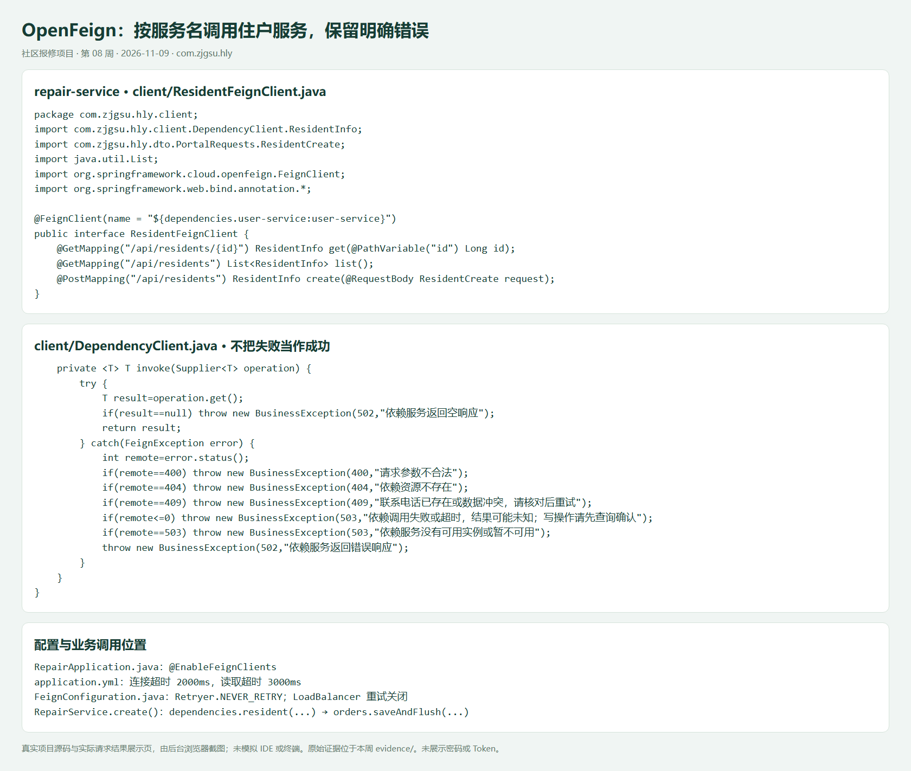
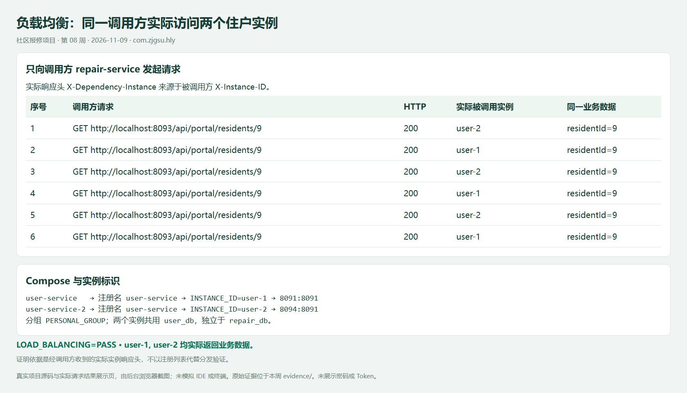
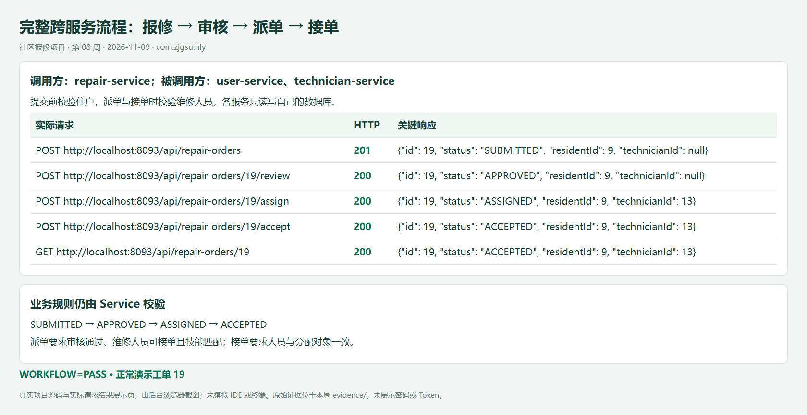
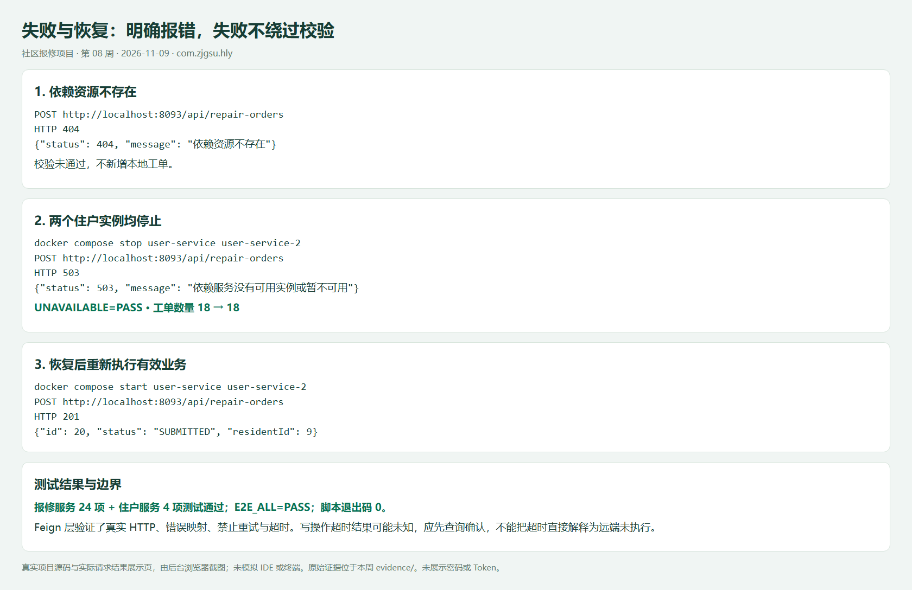

# 第 08 周：OpenFeign 与同步服务协作

## 1. 选择一个跨服务业务流程

沿用社区报修：创建工单前校验住户，审核通过后派单时校验维修人员，接单时再次校验人员。调用方 `repair-service`，被调用方 `user-service`、`technician-service`，完整接口与 Mermaid 链路图见 [服务通信设计](../../service-communication.md)。

## 2. 使用 OpenFeign

新增两个 Feign Client，使用服务名而非容器 IP。保留原有页面、DTO、Service 业务规则与数据库边界。`DependencyClient` 负责统一转换远端错误，禁止空响应或调用失败被当作业务成功；读取/连接超时及禁止重试配置均已明确。



## 3. 负载均衡验证

Compose 默认启动两个住户实例，共用住户服务自己的数据库，映射端口 8091、8094。两个实例均注册为 `user-service`。测试通过 8093 调用方请求住户业务 API，检查实际被调用实例返回的 `X-Instance-ID`，由 Feign 转发成 `X-Dependency-Instance`，断言两个实例均实际处理了请求。



## 4. 测试

从仓库根目录执行：

```bash
docker compose up -d --build
bash scripts/e2e-test.sh
```

脚本检查服务健康、两个实例的实际分发、提交→审核→派单→接单、资源不存在时 404 且不新增工单；随后停止两个住户实例，验证 503 和工单数量不变，恢复后再创建并查询新工单。失败时退出非零；退出处理会尝试恢复停掉的住户服务。无 Docker 权限时会请求本机 sudo 认证，密码不会写入日志或仓库。

自动化测试（Windows 在各服务目录运行 `mvnw.cmd test`，Linux 运行 `./mvnw test`）：

- 报修服务：Feign 的 GET/POST JSON、404/409/503、超时、空响应、重试次数、真实实例头转发，以及原有业务规则、API、工单删除测试。
- 住户服务：新增实例头与请求日志后保留原有 Repository/Service/API 测试。
- 测试使用 H2 和本机临时 HTTP 模拟服务，不连接真实 MySQL 或 Nacos。




超时场景的结果可能未知，原因及跨服务一致性边界见设计文档；实际验证结果保存在 `evidence/`。演示新增数据使用 Week08 Demo 名称和合成联系电话，不使用真实个人资料。

## 运行结果

2026-11-09 已完成 Windows 与 Docker 构建测试：报修服务 24 项，住户服务 4 项，均通过。

真实端到端验证退出码 0：`LOAD_BALANCING=PASS`，实际命中 user-1 与 user-2；工单 19 完成提交、审核、派单、接单；停止两个住户实例后返回 503，工单数 18 → 18；恢复后创建并查询工单 20 成功。当前两个住户实例及报修、维修人员服务均已恢复运行。

每次运行使用新生成的合成联系电话和演示描述，不清空数据库，不改动既有工单。`evidence/state.json` 记录本次演示 ID。所有截图来自本地源码和本次实际 HTTP 记录的展示页，未模拟 IDE 或终端。
