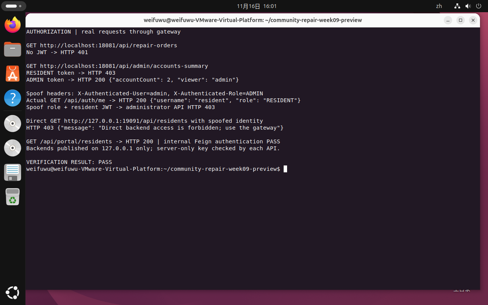

# 第九周大作业：API 网关与认证授权

本周在社区报修微服务原工程中新增 gateway-service，认证位于 user-service，保留原报修业务、服务边界和数据库数据卷。完整设计及测试账号角色见 [security.md](../../security.md)。

## 1. API Gateway

使用 Spring Cloud Gateway Server WebFlux，提供三条业务服务名路由和工作台静态资源路由；健康端点为 `/actuator/health`。网关容器端口 8080，宿主机使用可配置的 18081，避免与课堂应用冲突。

```bash
python3 scripts/init-auth-env.py
docker compose up -d --build
docker compose ps
curl -i http://localhost:18081/actuator/health
```

健康端点公开，业务 API 需要登录令牌。实际路由通过响应头 `X-Gateway-Route` 与 JSON 结果核对，不能只以容器启动作为完成依据。


## 2. 认证服务

`POST /api/auth/login` 从 user_db.login_accounts 读取账号与 BCrypt 哈希，比较密码后签发 30 分钟 JWT；使用 ADMIN 与 RESIDENT 两种角色。两个住户服务实例共享同一账号库。测试密码和密钥仅本地保存，不出现在截图及提交记录中。

```bash
bash scripts/auth-test.sh --section authentication
```

脚本内部使用真实密码登录并取得 JWT，只显示经过脱敏的响应。错误密码、篡改令牌、已过期令牌均需返回 401。


## 3. 网关鉴权

未登录请求业务返回 401；普通账号携带令牌可以访问业务，但调用管理汇总返回 403；管理员访问同一路径成功。额外验证伪造身份头会被覆盖，直接请求后端也被内部凭据过滤器拒绝。后端宿主机端口仅回环绑定。

```bash
bash scripts/auth-test.sh --section authorization
```



## 4. 测试脚本

```bash
bash scripts/auth-test.sh
```

脚本从仓库根目录运行，失败即非零退出；不写入或删除已有报修记录。单元测试覆盖密码哈希、JWT 角色和校验、防伪造身份、后端内部凭据，原业务测试同时回归。实际 HTTP 结果保存到 [evidence/auth-verification.json](evidence/auth-verification.json)。


网关及认证关键代码的 Ubuntu 终端截图：


## 提交位置

| 作业小题 | 推荐截图 |
| --- | --- |
| API Gateway | 01，可补充 05 |
| 认证服务 | 02，可补充 05 |
| 网关鉴权 | 03 |
| 测试脚本 | 04 |

材料应以实际验证为准，运行截图完成后再提交。测试账号分别为 admin/ADMIN 和 resident/RESIDENT，密码从本地环境文件获取。尚未实现记录级权限、刷新令牌、登录限流和正式密码重置，不将这些功能列为已完成。

## 本次 Ubuntu 实际验证环境

本次运行证据来自独立目录 `/home/weifuwu/community-repair-week09-preview`、Compose 项目 `community-repair-week09-preview`，使用独立数据库卷及 Nacos 的 `WEEK09_VERIFY_GROUP`。原 `/home/weifuwu/community-repair-week07` 运行环境与业务数据未替换。两套环境不能混用诊断端口或注册分组。

验证入口为 `http://192.168.158.128:18081/`，后端回环诊断端口为 19091（住户实例一）、19094（住户实例二）、19092（维修人员）、19093（报修）。验证库只包含本周新建的测试数据，不将其描述为原库历史业务数据。根目录 `compose.yaml` 提供正式更新配置；`compose.week09-verify.json` 是本次独立验证配置。

```bash
cd /home/weifuwu/community-repair-week09-preview
docker compose -f compose.preview.json ps
bash scripts/auth-test.sh
```

独立配置复现时先配置数据库及 Nacos 凭据、生成本地认证参数，设置 `BACKEND_TEST_URL=http://127.0.0.1:19091`，再运行 `docker compose -f compose.week09-verify.json up -d --build`。通过 `VERIFY_NACOS_ADDR` 指定现有 Nacos 地址。网关的健康成功后仍需等待业务实例注册完成，再执行认证脚本；若服务尚未就绪，脚本会如实失败而非忽略错误。

本机本轮测试合计 45 项通过：user-service 10、repair-service 24、technician-service 4、gateway-service 7。Ubuntu 本轮实际 HTTP 检查 17 项通过。运行证据和截图均不含实际密码、签名密钥或完整 JWT。
