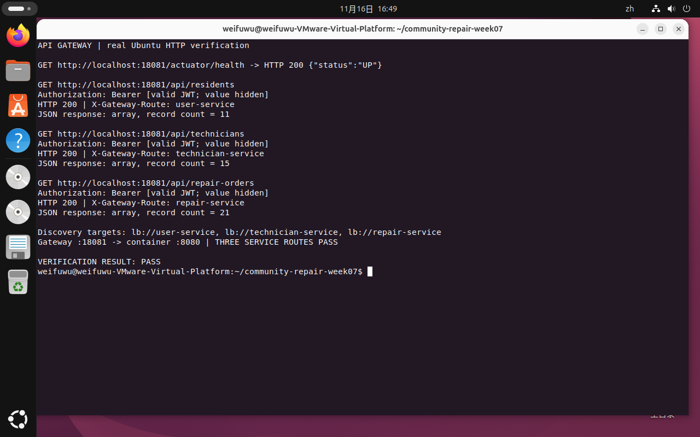
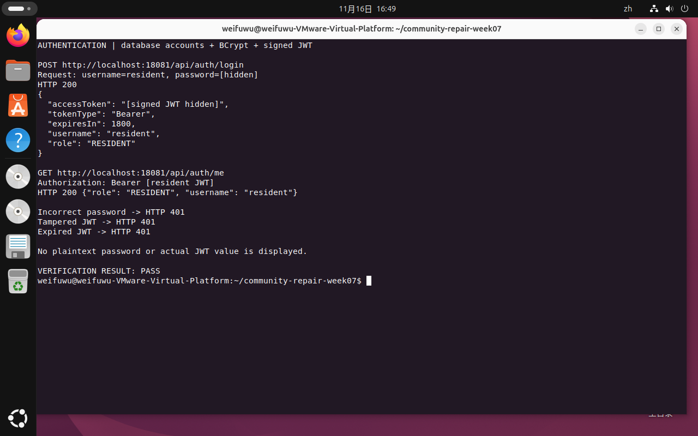
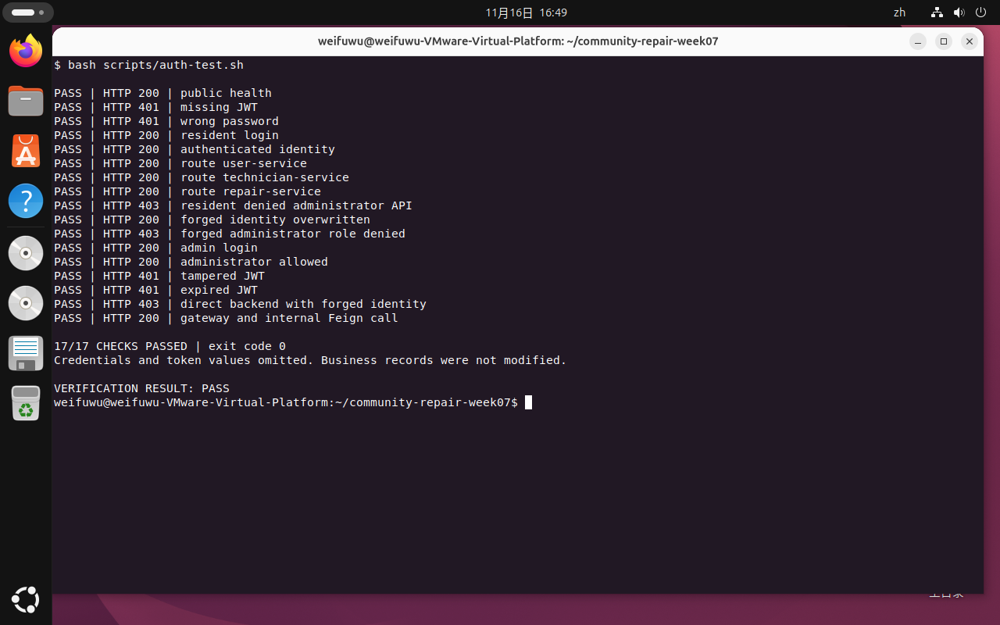
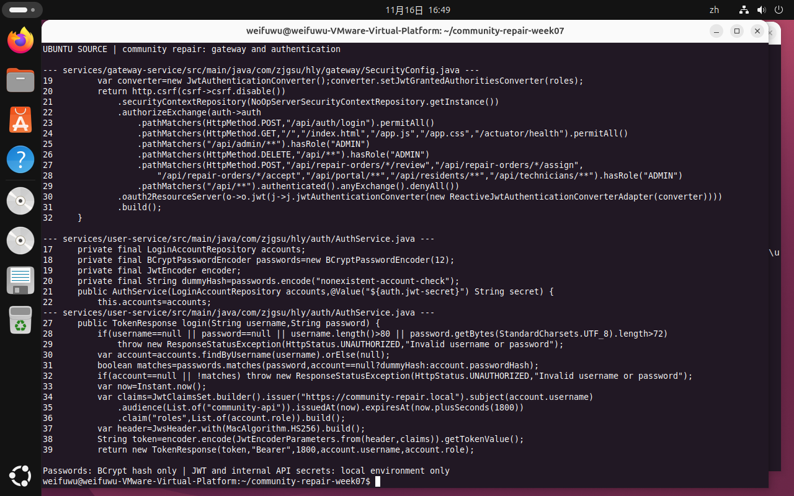

# 第九周大作业：API 网关与认证授权

本周在社区报修微服务原工程中新增 gateway-service，认证位于 user-service，保留原报修业务、服务边界和数据库数据卷。完整设计及测试账号角色见 [security.md](../../security.md)。

## 1. API Gateway

使用 Spring Cloud Gateway Server WebFlux，提供三条业务服务名路由和工作台静态资源路由；健康端点为 `/actuator/health`。网关容器端口 8080，宿主机使用可配置的 18081，避免与课堂应用冲突。

```bash
python3 scripts/init-auth-env.py
docker compose up -d --build
docker compose ps
curl -i http://localhost:18081/actuator/health
```

健康端点公开，业务 API 需要登录令牌。实际路由通过响应头 `X-Gateway-Route` 与 JSON 结果核对，不能只以容器启动作为完成依据。



## 2. 认证服务

`POST /api/auth/login` 从 user_db.login_accounts 读取账号与 BCrypt 哈希，比较密码后签发 30 分钟 JWT；使用 ADMIN 与 RESIDENT 两种角色。两个住户服务实例共享同一账号库。测试密码和密钥仅本地保存，不出现在截图及提交记录中。

```bash
bash scripts/auth-test.sh --section authentication
```

脚本内部使用真实密码登录并取得 JWT，只显示经过脱敏的响应。错误密码、篡改令牌、已过期令牌均需返回 401。



## 3. 网关鉴权

未登录请求业务返回 401；普通账号携带令牌可以访问业务，但调用管理汇总返回 403；管理员访问同一路径成功。额外验证伪造身份头会被覆盖，直接请求后端也被内部凭据过滤器拒绝。后端宿主机端口仅回环绑定。

```bash
bash scripts/auth-test.sh --section authorization
```


## 4. 测试脚本

```bash
bash scripts/auth-test.sh
```

脚本从仓库根目录运行，失败即非零退出；不写入或删除已有报修记录。单元测试覆盖密码哈希、JWT 角色和校验、防伪造身份、后端内部凭据，原业务测试同时回归。实际 HTTP 结果保存到 [evidence/auth-verification.json](evidence/auth-verification.json)。



网关及认证关键代码的 Ubuntu 终端截图：



## 提交位置

| 作业小题 | 推荐截图 |
| --- | --- |
| API Gateway | 01，可补充 05 |
| 认证服务 | 02，可补充 05 |
| 网关鉴权 | 03 |
| 测试脚本 | 04 |

材料应以实际验证为准，运行截图完成后再提交。测试账号分别为 admin/ADMIN 和 resident/RESIDENT，密码从本地环境文件获取。尚未实现记录级权限、刷新令牌、登录限流和正式密码重置，不将这些功能列为已完成。

## 本次 Ubuntu 原部署更新与验证

经用户确认后，已在原目录 `/home/weifuwu/community-repair-week07`、原 Compose 项目 `community-repair-services` 更新本周网关与认证配置。截图及运行证据已重新取自原环境，注册分组继续使用 `PERSONAL_GROUP`。

统一入口为 `http://192.168.158.128:18081/`。住户两个实例的回环诊断端口为 8091、8094，维修人员为 8092，报修为 8093；这些后端端口不再直接向局域网发布。原 Nacos 控制台仍使用 18088，数据库仍保留原有三个数据卷。

更新前已备份配置、源代码、三个数据库完整 SQL、原镜像标识及业务表快照，备份位于 Ubuntu 的 `/home/weifuwu/week09-backups/original-before-update-20261116/`。该私有备份包含数据库资料，不上传 GitHub。

更新前后逐字节比较原业务表数据快照，住户 11 条、维修人员 15 条、工单 21 条均未改变；三个数据库数据卷名称也一致。认证所需的账号表是本周新增内容，不覆盖原住户资料。保留两个住户服务实例，账号存放于同一个原 user_db。

```bash
cd /home/weifuwu/community-repair-week07
docker compose ps
bash scripts/auth-test.sh
```

本周代码本机服务测试合计 45 项通过，原 Ubuntu 部署实际 HTTP 验证 17 项通过，覆盖登录、未认证、越权、三条业务路由、伪造身份、令牌篡改/过期、后端直连和内部 Feign 协作。完整原部署校验见 [deployment-original.json](evidence/deployment-original.json)。

此前的独立预览容器已停止，预览数据库卷保留作验证记录；当前 18081 端口由原部署网关提供服务。`compose.week09-verify.json` 仅保留为可选独立验证配置，不要与当前环境同时占用同一网关端口。原部署启动使用根目录 `compose.yaml`。

本次终端截图和证据不包含实际密码、JWT 签名密钥或完整令牌。测试账号仍为 admin/ADMIN、resident/RESIDENT，密码只在本地环境文件中保存。
