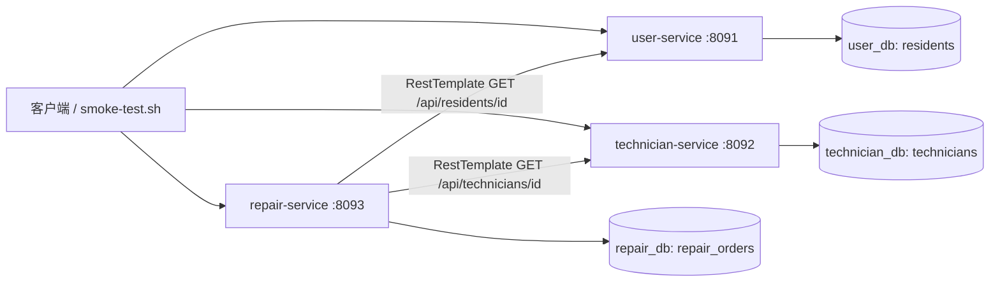

# 社区报修平台微服务拆分设计

保留 monolith/ 原单体版本；在 services/ 下建立三个独立 Maven 工程，基础包均为 com.zjgsu.hly，各自管理模型、Controller、Service、Repository、配置与测试。

## 拆分映射和数据所有权

| 原单体职责 | 微服务 | 端口 | 独立 MySQL / 数据库 | 应用账号 | 自有表 |
|---|---|---:|---|---|---|
| 工单输入中内嵌的住户信息 | user-service | 8091 | user-db / user_db | user_app | residents |
| Technician 及创建、查询 | technician-service | 8092 | technician-db / technician_db | technician_app | technicians |
| RepairOrder 和审核、派单、接单 | repair-service | 8093 | repair-db / repair_db | repair_app | repair_orders |

住户档案从工单输入中独立管理，本周不实现认证登录。人员服务拥有技能与可接单信息；工单服务聚合状态流程。三个 MySQL 8.4.11 容器、三个账号、三个命名卷隔离数据；数据库不公开宿主机端口。每个应用只获得自己数据库的密码，不拥有其他服务的数据库凭据。

工单 residentId 和 technicianId 是普通 Long 字段，不建立跨库外键，不使用跨服务 JPA 关联，不直接引用其他服务 Repository。住户姓名与电话保存为提交时的历史快照，来自住户服务而非客户端伪造值；之后资料变化不会自动覆盖历史工单。version 字段防止本地并发覆盖。

## 调用关系

## 跨服务业务流程

1. 创建住户档案和维修人员，获得各自 ID。
2. 提交工单时，repair-service 通过真实 HTTP 查询 user-service；校验成功后才写 repair_db，状态 SUBMITTED。
3. 审核通过进入 APPROVED。
4. 派单前通过 HTTP 查询 technician-service，校验存在、available=true、skill 匹配；成功后保存 technicianId，状态 ASSIGNED。
5. 被分配人员确认接单，校验其在人员服务中仍存在，进入 ACCEPTED。

创建返回 201，查询及操作成功 200；输入错误 400，资源缺失 404，状态/技能冲突 409，依赖错误响应 502，连接失败/超时 503。错误时不得跳过校验写入工单。住户缺失、住户服务停止时，工单数量不变；技能不匹配时仍为 APPROVED，technicianId 为 null。

## HTTP 配置

按作业要求使用 RestTemplate。repair-service/application.yml 中的 dependencies.user-url、technician-url 分别由 USER_SERVICE_URL、TECHNICIAN_SERVICE_URL 覆盖。连接超时默认 2000ms，读取超时 3000ms，环境变量为 HTTP_CONNECT_TIMEOUT_MS、HTTP_READ_TIMEOUT_MS。

Compose 内使用 http://user-service:8091 和 http://technician-service:8092，不使用 localhost 访问其他容器；宿主机单独启动时使用 localhost 默认值。应用启动等待各自数据库健康，smoke-test 检查所有应用健康。

## 一致性窗口和当前边界

远端 GET 校验和本地提交不属于同一原子事务。远端查询成功后，资料可能变化，本地事务也可能失败；HTTP 200 不保证工单保存成功。当前远端调用都是 GET，因此不会出现远端新增写入残留，但存在校验与提交之间的时间窗口。未来增加远端扣款或名额占用时，会出现远端已写、本地失败，需要后续幂等、消息、Saga 或补偿设计。

本周仅实现各自数据库、本地事务、基础 HTTP 和失败处理，不声称实现跨服务原子事务、自动补偿、消息、认证授权或生产级服务发现。旧单体数据不自动迁入新库，脚本每次创建自己的演示数据。

参考：[Spring HTTP 客户端](https://docs.spring.io/spring-framework/reference/integration/rest-clients.html)、[Compose 健康依赖](https://docs.docker.com/reference/compose-file/services/)。
