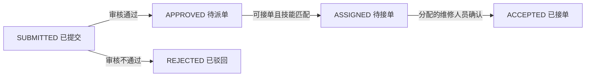

# 项目规划与第四周业务建模

## 项目名称和用户

**社区报修与上门维修服务平台**。目标用户为住户、物业管理员、维修人员和平台管理员。

## 本周实现的核心流程

住户提交故障及位置，生成待审核工单；物业审核通过后，选择具备对应技能且可接单的维修人员进行派单；被分配的维修人员确认接单，形成一次完整的报修受理流程。住户可通过工单查询接口查看处理结果。

本周的完成边界是“受理并接单”，不是完成全部上门维修服务。正式预约、实际维修、报价、库存、收费、验收和返修留待后续实现。驳回工单本周不支持原单重提，需重新创建工单。

## 核心实体及关系

| 实体 | 主要属性 | 作用 |
|---|---|---|
| Technician 维修人员 | id、name、phone、skill、available | 保存人员、单一技能及可接单状态 |
| RepairOrder 报修工单 | id、residentName、contactPhone、location、description、category、status、reviewNote、technician、createdAt、updatedAt、version | 保存故障、审核说明、派单关系及状态流转 |

一名维修人员可关联多个工单；工单在派单前可以没有维修人员，派单后只关联一名维修人员。JPA 使用单向 `ManyToOne`，数据库以 `repair_orders.technician_id` 外键关联 `technicians.id`。住户信息本周作为工单字段保存，没有额外实现用户或房屋实体。

## Service 中的业务规则

1. 只有 SUBMITTED 工单能够审核，只有 APPROVED 工单能够派单，只有 ASSIGNED 工单能够接单。
2. 派单必须同时满足维修人员 `available=true`，以及 `skill` 与工单 `category` 一致，否则返回 HTTP 409，工单保持原状态。
3. 接单请求的 technicianId 必须等于工单已分配人员的编号；重复接单及越过审核直接派单都返回 409。
4. 联系电话不可重复登记维修人员；数据库唯一约束同时防止并发重复创建。

`RepairService` 使用事务保存业务变更，工单使用 `@Version` 防止并发更新覆盖；Controller 只负责 HTTP 输入输出，Repository 承担数据库访问。请求使用 DTO 与 Bean Validation，响应使用 DTO，避免直接暴露 JPA 实体。

## 本周限制

目前未实现登录认证，接口中的住户和维修人员标识由调用者提交，仅用于课程流程演示，不能视为真实身份校验。`available` 表示是否可接单，不表示预约时段空闲；同一维修人员可以负责多个工单。本周不实现时间冲突检查、删除和重新派单。
