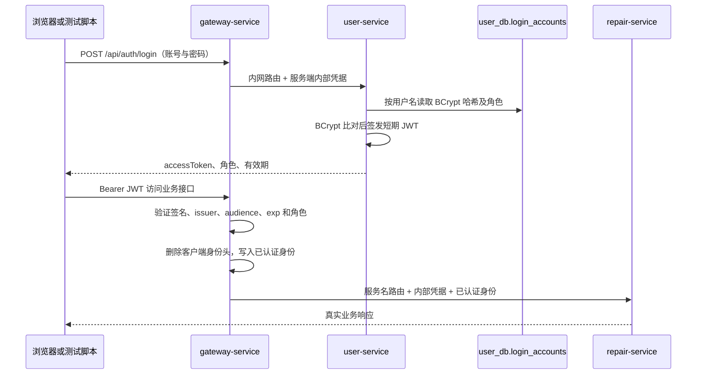

# 网关、认证与权限说明

## 请求链路与信任边界



网关宿主机入口默认 `18081`，容器内为 `8080`。本机 `8080` 已用于原有课堂应用，因此本周通过环境变量选择空闲端口。网关注册和发现使用 Nacos 的 `PERSONAL_GROUP`，与原个人业务服务一致。

## 路由表

| 匹配路径 | 目标 |
| --- | --- |
| `/api/auth/**`、`/api/admin/**`、`/api/residents/**` | `lb://user-service` |
| `/api/technicians/**` | `lb://technician-service` |
| `/api/repair-orders/**`、`/api/portal/**` | `lb://repair-service` |
| `/`、`/index.html`、`/app.js`、`/app.css` | `lb://repair-service`，工作台静态页面 |
| `/actuator/health` | 网关自身健康端点 |

`lb://` 按服务名发现实例，避免写死业务容器 IP；两个 user-service 实例共享原 user_db 中的账号和住户数据。

## 登录和密码

账号表 `login_accounts` 位于 user_db，字段为 ID、唯一用户名、密码哈希、角色。与住户业务表分开，不将密码添加到原有住户实体或 API 返回值中。BCrypt 使用随机盐和成本 12；数据库及源代码不保存明文登录密码。错误密码和未知账号均返回统一的 `401`。

| 测试账号 | 角色 | 权限 |
| --- | --- | --- |
| `admin` | `ADMIN` | 读取业务、审核、派单、接单、删除以及管理汇总 |
| `resident` | `RESIDENT` | 读取业务和创建报修；不能调用管理接口或进行管理操作 |

测试密码由 `python3 scripts/init-auth-env.py` 随机生成，只保存在本地 `.env` 的 `DEMO_ADMIN_PASSWORD` 和 `DEMO_RESIDENT_PASSWORD` 中。首次启动时才创建对应账号，重复启动不会覆盖已有哈希；修改环境变量不等于修改已存在账号的密码。请勿将本地 `.env`、真实密码、JWT 或签名密钥提交 GitHub。此处没有开放注册或密码重置接口。

JWT 使用 HS256，包含 `sub`、`roles`、`iss=https://community-repair.local`、`aud=community-api`、`iat`、`exp`，有效期 1800 秒。网关固定校验算法、签名、issuer、audience，要求 exp 存在并检查时间有效性。该 issuer 是令牌身份标识，不要求部署可访问的同名网站。签名密钥与内部调用密钥分别生成，至少 32 字节。

## 网关鉴权

- 登录 POST、工作台静态资源 GET 和健康 GET 公开；业务 API 必须携带有效 JWT。
- `/api/admin/**`、业务 DELETE、审核/派单/接单、住户和维修人员档案写入要求 `ADMIN`。
- 没有有效登录返回 `401`；已登录但角色不满足规则返回 `403`。未知路径默认拒绝。
- `TrustedIdentityFilter` 删除客户端的 `X-Authenticated-User`、`X-Authenticated-Role`、`X-Role`、`X-User-Id` 等身份头及伪造的内部凭据，只按已校验 JWT 写入可信身份；下游不接收原始 Bearer 令牌。

## 防止绕过网关

四个业务宿主机诊断端口（8091、8094、8092、8093）只绑定 `127.0.0.1`，不再向局域网直接发布。三个下游 API 还通过 `InternalRequestFilter` 校验仅服务端保存的 `X-Internal-API-Key`；直接请求后端或只伪造管理员身份头会返回 `403`。报修服务的 Feign 拦截器为正常服务间调用加入内部凭据，原有业务协作继续工作。管理汇总在 user-service 内也检查可信角色。

这是受信内网的课程方案；内部共享凭据不是用户 JWT，不能发给浏览器。若内网服务被攻破，共享凭据也可能泄漏，正式系统应进一步采用每服务身份、mTLS、密钥轮换和网络隔离。当前按角色区分操作，尚未实现“住户只能查看自己工单”的记录级授权；不应将本课程版本作为互联网正式部署。

## 工作台

统一通过 `http://<Ubuntu-IP>:18081/` 访问。登录后页面将 JWT 保存在内存，刷新页面需重新登录；每次 API 请求自动携带 Bearer，收到 `401` 时重新要求登录。普通账号点击管理员操作仍由服务器拒绝，页面按钮本身不是安全边界。

## 验证命令

从仓库根目录执行 `bash scripts/auth-test.sh`。该脚本读取本地测试密码，对未登录、登录、三条业务路由、越权、伪造身份、令牌篡改/过期、后端绕过和 Feign 协作进行断言；失败返回非零状态。它不修改已有业务记录，证据 JSON 不含密码或令牌值。

单元测试均不连接真实 Nacos/MySQL。依次在各服务目录运行 `./mvnw test`；gateway-service 没有独立 Wrapper，可在仓库根目录使用 `./services/user-service/mvnw -f services/gateway-service/pom.xml test`。

参考：[Spring Cloud Gateway](https://docs.spring.io/spring-cloud-gateway/reference/)、[Spring Security JWT](https://docs.spring.io/spring-security/reference/reactive/oauth2/resource-server/jwt.html)。

## 本次 Ubuntu 原部署更新与验证

经用户确认后，已在原目录 `/home/weifuwu/community-repair-week07`、原 Compose 项目 `community-repair-services` 更新本周网关与认证配置。截图及运行证据已重新取自原环境，注册分组继续使用 `PERSONAL_GROUP`。

统一入口为 `http://192.168.158.128:18081/`。住户两个实例的回环诊断端口为 8091、8094，维修人员为 8092，报修为 8093；这些后端端口不再直接向局域网发布。原 Nacos 控制台仍使用 18088，数据库仍保留原有三个数据卷。

更新前已备份配置、源代码、三个数据库完整 SQL、原镜像标识及业务表快照，备份位于 Ubuntu 的 `/home/weifuwu/week09-backups/original-before-update-20261116/`。该私有备份包含数据库资料，不上传 GitHub。

更新前后逐字节比较原业务表数据快照，住户 11 条、维修人员 15 条、工单 21 条均未改变；三个数据库数据卷名称也一致。认证所需的账号表是本周新增内容，不覆盖原住户资料。保留两个住户服务实例，账号存放于同一个原 user_db。

```bash
cd /home/weifuwu/community-repair-week07
docker compose ps
bash scripts/auth-test.sh
```

本周代码本机服务测试合计 45 项通过，原 Ubuntu 部署实际 HTTP 验证 17 项通过，覆盖登录、未认证、越权、三条业务路由、伪造身份、令牌篡改/过期、后端直连和内部 Feign 协作。完整原部署校验见 [deployment-original.json](homework/week-09/evidence/deployment-original.json)。

此前的独立预览容器已停止，预览数据库卷保留作验证记录；当前 18081 端口由原部署网关提供服务。`compose.week09-verify.json` 仅保留为可选独立验证配置，不要与当前环境同时占用同一网关端口。原部署启动使用根目录 `compose.yaml`。

本次终端截图和证据不包含实际密码、JWT 签名密钥或完整令牌。测试账号仍为 admin/ADMIN、resident/RESIDENT，密码只在本地环境文件中保存。
