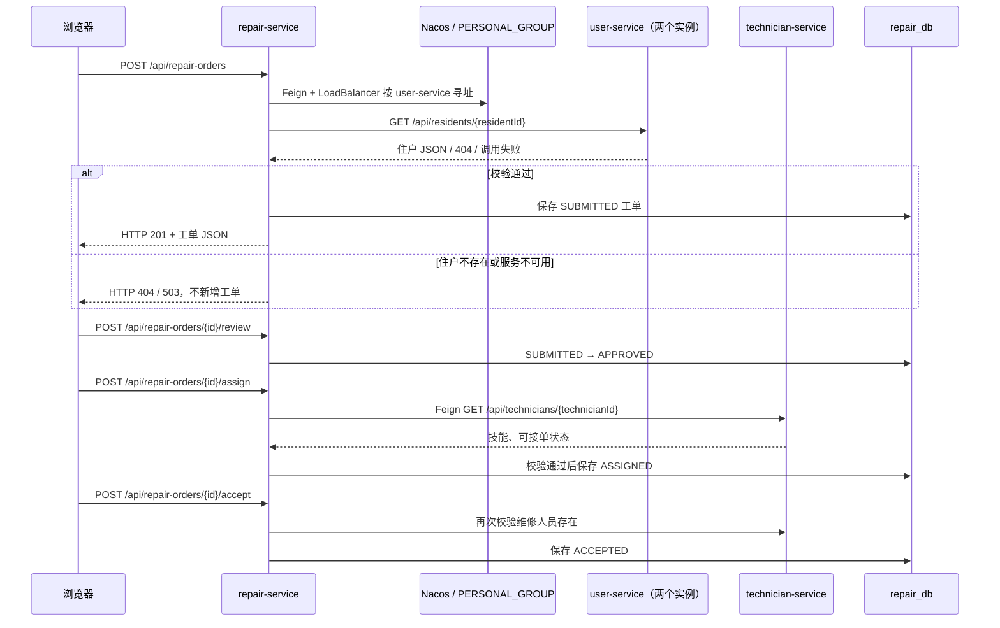

# 第八周：社区报修的同步服务协作

## 业务链路与数据边界

调用方为 `repair-service`，被调用方为 `user-service` 和 `technician-service`。三个服务分别拥有 repair_db、user_db、technician_db。住户服务的两个实例共享本服务的 user_db；工单服务不跨库读取住户或维修人员表。

## 调用实现

`ResidentFeignClient`、`TechnicianFeignClient` 使用服务名，没有设置固定 URL。Spring Cloud 2025.1.0 BOM 管理 OpenFeign 和 LoadBalancer 版本，Nacos 的分组及凭据继续通过环境变量注入。`DependencyClient` 保留原有业务接口，内部改用 Feign 代理，界面及 Service 层调用方式不变。

| 调用场景 | 调用方接口 | Feign 被调用接口 |
| --- | --- | --- |
| 报修前校验住户 | POST /api/repair-orders | user-service GET /api/residents/{id} |
| 派单前检查人员 | POST /api/repair-orders/{id}/assign | technician-service GET /api/technicians/{id} |
| 接单前检查人员 | POST /api/repair-orders/{id}/accept | technician-service GET /api/technicians/{id} |
| 界面住户查询/新增 | GET/POST /api/portal/residents | user-service GET/POST /api/residents |
| 验证实际分发 | GET /api/portal/residents/{id} | user-service GET /api/residents/{id} |

有响应体的操作返回 JSON；无响应体的工单删除返回 HTTP 204。

## 双实例及可核验标识

Compose 启动 `user-service` 和 `user-service-2`，两者均注册为 `user-service`，组为 `PERSONAL_GROUP`，但具有不同容器 IP。宿主机分别映射 8091 和 8094，避免端口冲突。调用方通过注册中心获取实例，8094 仅用于宿主机检查第二实例的健康状态。

住户服务通过 `X-Instance-ID` 返回实际处理该请求的实例标识 `user-1` 或 `user-2`，并记录 `BUSINESS_HTTP` 日志。Feign 响应拦截器把真实响应中的标识转发为 `X-Dependency-Instance`，记录 `FEIGN_RESPONSE` 日志。端到端脚本只向调用方 8093 发业务请求，断言响应中确实出现两个标识；不以注册列表或直接访问两个端口代替负载均衡证明。

## 失败、超时与一致性边界

- 400/404/409 保留明确的输入或业务错误；依赖无实例、暂不可用或网络错误返回 503；依赖异常响应或空成功响应返回 502。
- 连接超时默认 2000ms，读取超时默认 3000ms，可通过环境变量覆盖。
- Feign 和 LoadBalancer 均关闭自动重试，尤其不自动重放创建类 POST。
- 超时不能证明远端没有执行写操作。页面创建住户等操作可能在远端已提交、本地未收到响应，应先查询核对，再决定是否重试。错误提示明确说明“结果可能未知”。
- 报修创建当前先远程读取住户，再本地保存；派单先远程读取人员，再本地保存。两步之间仍有状态变化窗口，`@Transactional` 只保护本地数据库，不提供分布式原子事务。
- 本周未实现熔断、自动补偿、消息事务或生产级高可用。

参考：[Spring Cloud OpenFeign 官方文档](https://docs.spring.io/spring-cloud-openfeign/reference/spring-cloud-openfeign.html)、[LoadBalancer 配置](https://docs.spring.io/spring-cloud-openfeign/reference/configprops.html)。
